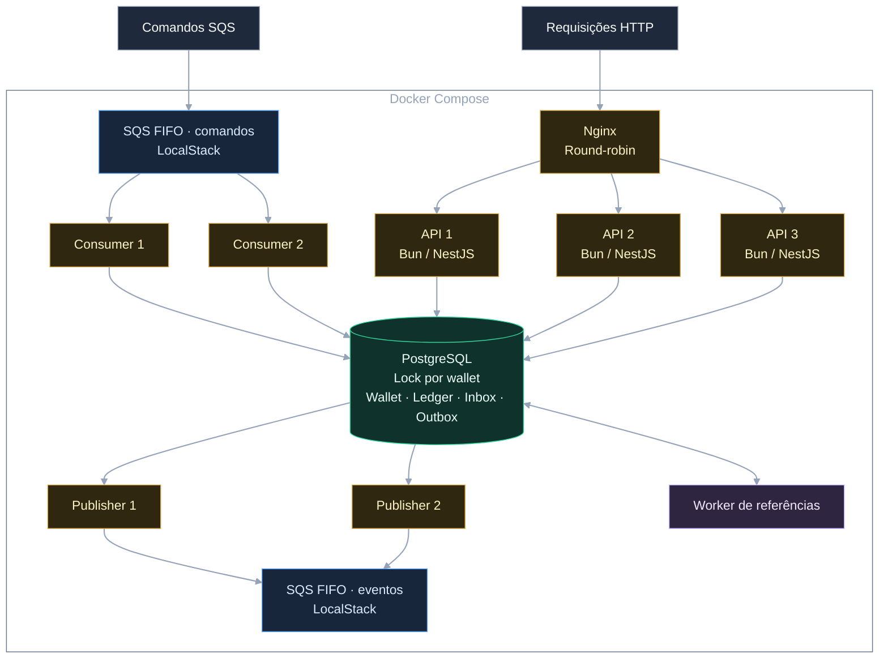

# Distributed Wagering Processor

Serviço financeiro para o [backend challenge da Jungle Gaming](https://github.com/junglegaming/backend-challenge).
Recebe apostas por HTTP e SQS, registra cada movimento em um ledger e publica
os eventos confirmados. PostgreSQL coordena o saldo e a idempotência entre
instâncias, inclusive quando mensagens chegam duplicadas ou fora de ordem.

<div align="center">



</div>

APIs e consumers executam o mesmo `ProcessWagerUseCase`. O worker de referências
resolve as operações pendentes, persiste os resultados no banco e grava os eventos
na Outbox no mesmo commit financeiro. Os publishers enviam esses eventos para SQS.

## Execute com Docker

Requer Git e Docker Engine/Desktop com Compose v2 e containers Linux.
Não precisa instalar Bun, Node.js, PostgreSQL ou AWS CLI no host.

```sh
git clone https://github.com/self1027/tt-junglegaming-backend.git
cd tt-junglegaming-backend
docker compose -f compose.demo.yaml up -d --build --wait
```

O Compose compila a imagem, sobe PostgreSQL e LocalStack e executa os jobs de
migrations e provisionamento das filas. Depois inicia as APIs e os workers.
Nginx espera as três APIs ficarem saudáveis e atende em `http://127.0.0.1:3000`.
É o único serviço com porta publicada no host. As credenciais são locais e o
setup dispensa `.env`.

## Teste a solução

```sh
docker compose -f compose.demo.yaml run --rm smoke
```

O smoke cria uma wallet com `100.00 BRL` e envia duas BETs de `80.00` em paralelo.
Os headers do Nginx confirmam que cada BET chegou a uma API diferente. Uma é
processada e a outra é rejeitada: o saldo fica em `20.00`, com um único débito.

Depois, 50 replays concorrentes passam pelas três APIs e retornam o resultado
histórico. O smoke também verifica conflito de payload, entrega duplicada por
SQS, eventos da Outbox e resolução de REFUND enviado antes da BET.

```text
PASS  Readiness through Nginx: …
PASS  Concurrent bets: 100/80/80; PROCESSED …, REJECTED …
PASS  Ledger and reconciliation: 20.00 BRL, one debit
PASS  Idempotent replay and divergent payload conflict
PASS  50 concurrent historical replays: …
PASS  SQS processing: …
PASS  Pending reference resolution: …
PASS  Transactional Outbox: 10 matching eventIds received; …

ALL CHECKS PASSED
```

Cada execução usa identidades novas e consulta respostas, ledger, Inbox/Outbox e
eventos reais. Pode repetir sem apagar o banco. O [quickstart](docs/quickstart.md)
traz health, logs e solução de problemas.

## Teste de carga

Com a demo já iniciada, execute o perfil Quick:

```sh
docker compose -f compose.demo.yaml run --rm load
```

Para o Standard, use `docker compose -f compose.demo.yaml run --rm -e LOAD_PROFILE=standard load`.
Com Bun instalado, `bun run test:load` executa o mesmo driver no Docker e acrescenta
metadados do host. Os relatórios JSON e Markdown ficam em `load-results/`.

O benchmark compara wallets independentes com uma hot wallet para observar a
espera pelo lock financeiro. Também mede replays e o fluxo SQS/Outbox, com
throughput, percentis reais, erros, drenagem e reconciliação. Consulte a
[metodologia e os resultados](docs/testing/load-test.md). Execute uma carga por vez;
o teste mantém os dados financeiros e os eventos na demo.

## O que foi implementado

- Dinheiro exato em centavos (`bigint`), com strings decimais nos contratos.
- Lock pessimista por wallet e constraints SQL para concorrência entre instâncias.
- Idempotência persistente, conflito de payload e replay do saldo histórico.
- Ledger imutável e reconciliação por snapshot, sem correção silenciosa.
- Inbox no mesmo commit financeiro; ACK depois do commit. Outbox transacional.
- Recuperação por redelivery e claims com lease/token e fencing.
- Reversões integrais e worker para referências fora de ordem, conforme a
  [política RE-03](docs/domain/wagering.md#políticas-e-reversões).

## Testes e CI

O [GitHub Actions](https://github.com/self1027/tt-junglegaming-backend/actions/workflows/ci.yml)
separa checks estáticos, suíte completa com PostgreSQL/LocalStack reais e smoke
Docker. Consulte a execução do commit para conferir o resultado.

Com Bun **1.4.4** e Docker instalados:

```sh
bun install --frozen-lockfile
bun run test
```

A suíte cria ambientes descartáveis próprios; inclui processos concorrentes,
falhas, recuperação e exemplos executáveis Bash/curl. A primeira execução baixa
imagens e pode levar vários minutos. Veja a [estratégia de testes](docs/testing/strategy.md).

## Arquitetura e limitações

O monólito modular hexagonal tem quatro tipos de processo independentes.
Financial mantém saldo e ledger; Wagering coordena as operações; os adapters
implementam HTTP, SQL e SQS. A aplicação usa Bun, TypeScript strict, NestJS e MikroORM.

A topologia da demo é fixa. TLS, Kubernetes, replicação do banco e autoscaling
ficam fora do escopo.

Eventos têm entrega at-least-once: consumidores precisam deduplicar por `eventId`.
Autenticação foi omitida conforme o desafio, com ponto de extensão para IdP.
Métricas são JSON, sem backend agregado. A demo mantém PostgreSQL em volume;
recriar LocalStack perde suas mensagens e não republica eventos já marcados como
PUBLISHED. É um ambiente local, sem backup/failover ou validação de IAM na AWS.

[Arquitetura e decisões](ARCHITECTURE.md) · [Requisitos e evidências](docs/requirements.md) ·
[Contratos e guias técnicos](docs/index.md) · [Desenvolvimento local](docs/operations/local-development.md)

## Parar a demonstração

```sh
docker compose -f compose.demo.yaml down
```

O volume PostgreSQL e seu histórico são preservados. `down --volumes` apaga os
dados da demo; use somente se quiser descartá-los.
